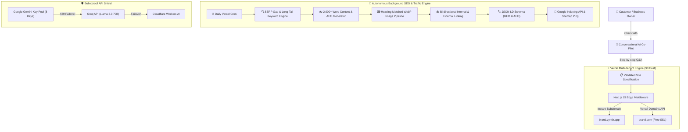

# 👑 ZYNTIX AUTONOMOUS AI WEB PLATFORM
## The 10,000% Final Master Architectural Blueprint

---

### Executive Vision & Core Principles
* **Platform Name:** Zyntix Autonomous AI Web Platform (Multi-Tenant SaaS)
* **Hosting & Maintenance Cost:** **$0.00 / Month Forever** (Runs on Vercel Free Tier, Supabase Free Tier, Google AI Studio Free Tier, Pollinations/Unsplash Free APIs).
* **Target Audience:** Small businesses, agencies, contractors, local service providers, and niche affiliate builders.
* **Core Value Proposition:** Build, host, design, optimize, publish, and rank websites on 100% autopilot with zero technical effort required from the client.

---

---

## 1. The "Customer-Directed" Interactive Co-Pilot (Chatbot)
1. **Strict Obedience (No Wild Guesses):**
   * The bot acts strictly as an intelligent assistant, asking targeted questions:
     * *Business niche & primary geographical service area.*
     * *Specific services & products offered.*
     * *Branding preferences (Color theme, tone, visual style).*
     * *Required pages (Home, Services, About, Pricing, Contact/Booking).*
2. **Conversational Real-Time Edits:**
   * After the initial site generation, the client can command modifications in plain English or Urdu:
     * *"Change the accent color from green to midnight blue."*
     * *"Add a 24/7 emergency service banner to the homepage."*
     * *"Update my phone number and office hours."*
   * The bot updates the database schema, triggering instant ISR revalidation on the live preview.

---

## 2. Multi-Tenant Infrastructure ($0 Overhead)
* **Single Master Codebase:** Deployed once on Vercel. One Next.js 15 application handles infinite client websites.
* **Instant Free Subdomains:** Every customer receives an instant live staging domain (`clientname.zyntix.app`) within 1 second.
* **Database & Persistence:** Supabase / Neon Serverless Postgres ($0 Free Tier) stores site configurations, layouts, and articles.
* **Edge Middleware Routing:** Requests to `domain.com` or `subdomain.zyntix.app` are routed dynamically at the edge to serve client-specific data.

---

## 3. Automated Custom Domain & DNS Engine
* **Vercel Domains REST API Integration:** When a customer provides their custom domain, the backend automatically issues:
  `POST https://api.vercel.com/v9/projects/{projectId}/domains`
* **Zero-Confusion Guided Visual Flow:**
  * The bot prompts: *“Where did you purchase your domain? (GoDaddy, Namecheap, Hostinger)?”*
  * Displays a 3-step visual guide tailored to that registrar with 1-click copy buttons:
    * `A Record: @ -> 76.76.21.21`
    * `CNAME Record: www -> cname.vercel-dns.com`
* **Automated SSL:** Vercel automatically provisions and renews Let's Encrypt SSL certificates (HTTPS) for every custom domain.
* **VIP Concierge Fallback:** A 1-click *"Let Our Team Connect It"* button for clients who prefer delegate setup.

---

## 4. Autonomous SEO, AEO & Traffic Generation Engine
* **Cadence:** 2 to 3 high-authority articles per day per site (fully natural velocity).
* **SERP Gap & Long-Tail Targeting:** Targets high-intent queries (1,000–10,000 monthly search volume) where outdated forums (Reddit, Quora) currently rank on page 1.
* **AEO (Answer Engine Optimization):** Generates a 45-word direct answer block at the top of each article to capture Google Featured Snippets (#0 position).
* **GEO (Generative Engine Optimization):** Embeds structured facts and schema so that AI search engines (ChatGPT, Google Gemini, Perplexity) cite the website as an authoritative source.
* **Bi-Directional Linking Mesh:**
  * New articles link to 2–3 existing relevant internal articles.
  * The engine dynamically injects reciprocal backlinks into 2 older articles pointing to the new piece.
  * Injects high-authority external citations (.gov, .edu, Wikipedia) to fulfill Google's E-E-A-T criteria.

---

## 5. Heading-Matched Image Engine
* **Context-Driven Image Mapping:** Every H2 and H3 heading receives a dedicated visual asset matching the exact topic of that section.
* **$0 Image Generation Pipeline:**
  * Generates custom, photorealistic images via Pollinations.ai / Free Edge API ($0, no paid subscriptions).
  * Dynamic fallback to high-res, royalty-free photography via Unsplash/Pexels API.
* **Automated Image SEO:**
  * Injects descriptive, keyword-rich Alt-tags for Google Images search rankings.
  * Auto-compressed to `.webp` format with responsive sizes and lazy-loading for 100/100 Core Web Vitals.

---

## 6. Autonomous Google Indexing Machine
* **Google Indexing API Direct Ping:** Triggers a `URL_UPDATED` notification to Google's indexing endpoints within seconds of publishing.
* **Dynamic XML Sitemap:** Automatically updates and pings Google Search Console.
* **IndexNow Protocol:** Submits instant notifications to Bing and other search engines within 5 seconds.

---

## 7. Bulletproof API Failsafe & Rate-Limit Shield
* **Multi-Key Pool:** Rotates requests across a pool of 8+ free Google AI Studio keys via round-robin distribution.
* **Multi-Provider Failover:**
  1. Primary: Google Gemini 1.5 Flash (Free Tier).
  2. Fallback A: Groq API / Llama 3.3 70B (Free Tier, ultra-fast).
  3. Fallback B: Cloudflare Workers AI / Mistral (Free Tier).
* **Exponential Backoff:** Automatic retry with jitter upon any 429 rate limit to ensure 100% uptime.

---

## 8. Design & Quality Standards
* **Framework:** Next.js 15 (App Router), Tailwind CSS, Lucide Icons, Shadcn UI primitives.
* **Performance:** Strict 100/100 Google PageSpeed score, Cumulative Layout Shift (CLS) = 0.
* **Code Integrity:** Strict TypeScript mode, Zod input validation, React Error Boundaries.

---

## 9. Competitor-Crusher: Autonomous Pinterest & Visual Traffic Syndication Engine
*(Reverse-Engineered & Enhanced from Awais Ahmed's Strategy)*
* **Visual Search Moat:** For high-intent visual niches (home decor, fencing, plumbing, landscaping), Pinterest drives 10x higher organic referral traffic than slow Google crawls.
* **Auto-Pin Generation (1000x1500 Vertical):**
  * For every published article, automatically synthesizes 3 to 5 high-converting vertical Pinterest Pins.
  * Injects bold typography heading overlays, high-contrast badges, and brand watermarks via Pollinations.ai + SVG/Canvas rendering.
* **Pinterest AEO & SEO Metadata:**
  * Auto-generates high-intent Pin Titles, SEO-rich descriptions with hashtags, and targeted board recommendations.
* **Safety Capping:** Strictly throttled to 5 pins/day per domain to protect domain reputation and prevent shadowbans.
* **Zero-Manual Automation:** Replaces the competitor's manual Google Sheets workflow with a 1-click publishing queue and autonomous webhook scheduler.
